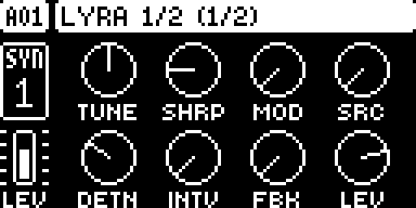
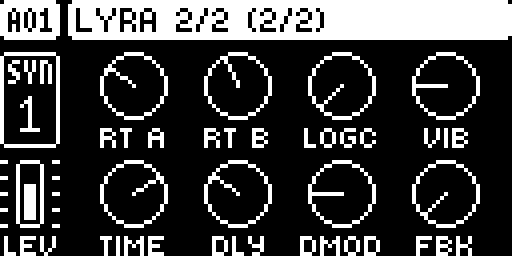
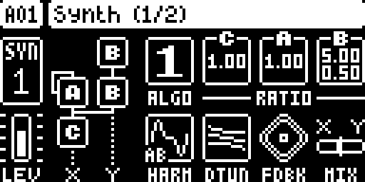
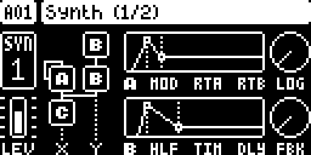
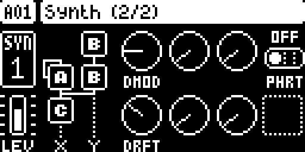

# LYRA for Digitone mk1 / Keys — LYRA and LYRA LITE 0.3, LYRA FM 0.1

A port of LYRA ([the Digitakt mk1's](../README.md)) to the Digitone mk1 and Digitone Keys, OS 1.44.
Same sound engine: four triangle oscillators in two pairs, SHRP/DRIVE, MOD from SRC (SELF, PAIR,
HLFO, CHN, DLY, TRK), the HYPER LFO, and the delay network (FBK, TIME, DLY, DMOD). The Digitone's
own filter, effects and AMP envelope follow it.

## Install

From this repository's [Releases](../../../releases) (the `digitone-0.3` one): build a firmware with
elekloader's `patch` tool, or in the [Mod Shop](https://elekloader.github.io/shop/) as files of your
own, from your stock OS 1.44 and these four, unticking the shop's own core and machines (they are
older):

- `core-5.3-os1.44.elemod` and `machines-0.6-os1.44.elemod` (elekloader's, built from its source)
- `lyra-dn-0.3-os1.44.elemod`: LYRA and LYRA LITE
- `lyra-fm-0.1-os1.44.elemod`: LYRA FM

Hold a track key, Mod Menu → MACHINES. Firmware builds are not published here: they contain
Elektron's OS.

## The knobs

| page | A | B | C | D | E | F | G | H |
|---|---|---|---|---|---|---|---|---|
| LYRA 1/2 | TUNE (±24 semitones) | SHRP | MOD | SRC | DETN | INTV | FBK | LEV |
| LYRA 2/2 | RT A | RT B | LOGC | VIB | TIME | DLY | DMOD | FBK |

What each does: [the Digitakt LYRA's README](../README.md). SRC, INTV and LOGC step through their choices.

## LYRA LITE

A second machine in the same mod, LYRA LITE (pages LITE 1/2, 2/2), with the same knobs: one
oscillator a pair instead of two (the pairs still beat against each other with DETN and INTV),
the HYPER LFO at 12 kHz and the delay at 6 kHz (its echoes were darkened to 2.5 kHz already, and
now top out at 3 kHz). About a third lighter than LYRA. With fewer detuned oscillators cancelling,
it is a little louder. Use LYRA for one or two main drones and LITE for the rest.

## LYRA FM (`lyra-fm/`)

A third machine, a mod of its own: LYRA
played by the Digitone's FM engine. The four FM operators are LYRA's oscillators, and the FM chip plays
them; the main CPU only steers them and runs the delay.

- **SYN1**: FM's own page, unchanged (ALGO, ratios, HARM, DTUN, FDBK, MIX; the ratio offsets on 2/2).
  LYRA moves them around: the HYPER LFO on the detune and pair 2's ratios, DRFT a slow random drift on
  each operator's ratio, FBK the echoes into the modulators, the operators' feedback and pair 2's ratios.
- **SYN2 1/2**: MOD (the FM index: the modulators' levels), RTA and RTB (the HYPER LFO's rates), LOG
  (SUM, AND, OR, XOR, S&H, CHS), HLF (its depth), TIM, DLY, FBK. This page shows three letters.
- **SYN2 2/2**: DMOD, PHRT (FM's), DRFT.
- The operators' envelopes are held open (it's a drone); the AMP page shapes the note.
- **Polyphonic**: each of the 8 voices has its own LFOs, drift and delay.
- **What it can't do**: the echoes reach the oscillators about 1,500 times a second, not at audio rate,
  so FBK gives slow swinging chaos rather than LYRA's ring-modulated scream; the operators are FM's
  sines (HARM and FDBK give them edges). The Digitone's LFOs pointed at a SYN2 knob move FM's operator
  setting behind it, not LYRA's control.

Load in digiemu: 58.5 % stock, 62.5 % with one LYRA FM voice, 66.8 % with four, 76.5 % with all eight:
about 1.4 % a voice after the first, and 2.5 % once LYRA FM is on a track. A voice that has been silent
for a second sleeps.

## One voice per track

LYRA plays one note a track at a time (legato): a new note moves the running drone's pitch, and
the oscillators, HYPER LFO and delay carry on. Up to four LYRAs, one a track. TRK links tracks
1-2 and 3-4.

## CPU

The whole Digitone's load in digiemu (busy cycles of all, with its cycle model;
`lyra-dn/tests/test_lyra_dn_load.py`). The stock OS alone keeps the main CPU about 58 % busy with audio:

| | LYRA 0.1 | LYRA 0.2/0.3 | LYRA LITE |
|---|---|---|---|
| nothing playing | 58 % | 58 % | 58 % |
| one voice | 66 % | 64 % | 63 % |
| four voices | 87 % | 78 % | 73 % |

LYRA FM (polyphonic): one voice 62.5 %, four 66.8 %, eight 76.5 %.

About 7 % a voice in 0.1, 5.4 % in 0.2 and 0.3 (voices at 24 kHz), 3.6 % for LITE. A released
note keeps its voice running until the AMP release ends. The model counts memory as instant;
on the unit it is slower, so leave room.

## Tested

In digiemu with the real OS 1.44 (`lyra-dn/tests/test_lyra_dn.py`, elekloader's SDK harness): LYRA is
picked from MACHINES, both pages draw with their labels and value names, a held key plays at
its pitch, defaults and an all-nonlinear patch sound, three held keys sound one voice, and four
LYRA tracks play at once (one voice each, TRK on track 4) without the firmware halting. Linked
with elekloader's check (RAM 190,832 of 1,310,720 bytes). On the PC its sound matches the
Digitakt LYRA's (same pitch and level on a plain patch).

**Not tested:** LYRA LITE and LYRA FM on a unit. LYRA 0.1 ran on one and was too heavy with several tracks (hence 0.2, LITE and FM).

## Known

- The knob pop-up's title names the Digitone parameter the knob is stored in (for example
  "A Level=TRK"): machines-dn1 does that for every SDK machine.
- A track that rests and comes back on a different voice resumes its echoes where they stopped
  rather than decayed.
- Not affiliated with SOMA Laboratory or Elektron. GPL-2.0-or-later.

 

  
